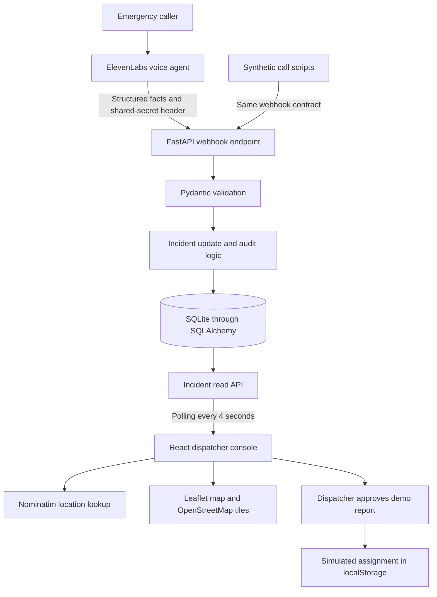

# Relay4

** An emergency dispatch assistant. Clearer information for dispatcher decisions.**
**Team 404**

Relay4 turns emergency intake conversations into incident records that a dispatcher can review on a Louisiana map. The voice agent sends structured facts to a Python API, the API preserves changes and caller statements, and the dashboard brings the information together as the call develops.

This repository contains the synthetic hackathon MVP: a FastAPI backend, a React dispatcher console, and scripts that simulate incoming calls. Incident storage and correction history run on the backend. Responder selection and report approval run as a browser simulation.

## Read the project in order

1. **This page:** purpose, technical architecture, local startup, and demo flow.
2. **[Backend README](backend/README.md):** configuration, API contract, persistence, authentication, and tests.
3. **[Frontend README](frontend/README.md):** dashboard behavior, mapping, decision support, and simulated assignments.

## What Relay4 does

- Creates an incident when the first authenticated voice-tool event arrives for a conversation.
- Updates that incident as the caller supplies more information. Each changed fact retains its previous value in the audit history.
- Stores caller quotes and transcript references as unverified evidence.
- Displays incident summaries, missing facts, location confirmation, and reported hazards in a dispatcher console.
- Maps locations within Louisiana and shows parish context from bundled boundary data.
- Calculates priority recommendations and flags potentially related calls with explicit reasons.
- Drafts a responder report and requires the dispatcher to approve the simulated assignment.

Missing incident facts remain unknown. A reported location, a geocoded point, and caller confirmation are separate pieces of information; the map does not verify a caller's account.

## Technical stack

Versions below reflect the repository manifests. The frontend lockfile records resolved JavaScript dependencies.

| Layer | Technology | Responsibility |
| --- | --- | --- |
| Voice intake | ElevenLabs Conversational AI integration | Sends structured incident facts through a server-side webhook tool |
| API | Python 3.11+, FastAPI 0.115.6, Uvicorn | Serves incident routes and receives voice-tool events |
| Validation and configuration | Pydantic 2, pydantic-settings 2 | Validates request data and loads environment settings |
| Persistence | SQLAlchemy 2, SQLite | Stores incidents, evidence, conversation bindings, processed events, and history |
| Dispatcher console | React 19, TypeScript 6, Vite 8 | Renders the dashboard and polls incident records |
| Mapping | Leaflet 1.9, React Leaflet 5, OpenStreetMap tiles | Displays incidents and Louisiana geography |
| Location lookup | OpenStreetMap Nominatim | Converts reported location text into coordinates in the browser |
| Local demo state | Browser localStorage | Retains simulated assignments and geocoding results |
| Checks | pytest 8, HTTPX 0.28.1, ESLint 10, TypeScript | Tests the backend and checks frontend code |

DeepSpace appears in the original project concept but has no implementation in this repository. The running dashboard uses React and the FastAPI incident endpoints.

## Technical architecture



The webhook authenticates requests with a configured shared secret. HTTPS is supplied by the deployment or tunnel; the local Uvicorn command serves HTTP. SQLite holds the incident record and audit history. The browser reads those records and calculates map context, priorities, related-call flags, and unit recommendations.

The frontend does not write incident corrections to the API. Corrections arrive through new voice-tool events or authenticated manual API requests. Assignment approval stays in the browser and does not create a backend assignment or contact a responder.

## Run locally

Install Python 3.11+ and Node.js 20.19+ within the 20.x line, or Node.js 22.12+. This matches the installed Vite package’s engine range. Use npm with the committed lockfile.

### 1. Start the backend

Run from the repository root:

```bash
cd backend
python3 -m venv .venv
source .venv/bin/activate
python -m pip install -r requirements.txt
cp .env.example .env
```

Edit `backend/.env`. Set `ELEVENLABS_WEBHOOK_SECRET` and `ADMIN_API_KEY` to different random values, then start the API from `backend/`:

```bash
uvicorn app.main:app --reload --port 8000
```

The service exposes [health](http://127.0.0.1:8000/health) and [interactive API documentation](http://127.0.0.1:8000/docs). With the default database URL, starting from this directory creates or opens `backend/relay4.db`.

### 2. Start the frontend

In a second terminal, run from the repository root:

```bash
cd frontend
cp .env.example .env
npm ci
npm run dev -- --host 127.0.0.1 --port 5173
```

Open [the dispatcher console](http://127.0.0.1:5173). The frontend uses `VITE_API_BASE_URL=http://localhost:8000`. The backend example configuration permits the local development origins on ports 5173 and 5174.

### 3. Send a synthetic call

In a third terminal, run from the repository root:

```bash
cd backend
source .venv/bin/activate
python scripts/simulate_call.py flood
```

The script reads the webhook secret from `backend/.env` and sends three updates, four seconds apart. Each run creates a new conversation. Available scenarios are `fire`, `flood`, `medical`, `crash`, and `all`.

## Walk through the demo

1. Run a synthetic call and watch the incident appear after the next dashboard poll.
2. Open the incident to inspect its summary, reported facts, and unverified caller statements.
3. Follow the pin on the Louisiana map. Location lookup requires an internet connection and a place the geocoder recognizes.
4. Review the priority reasons and unanswered intake questions.
5. Review the proposed unit and report, then select **Approve & send** to record a simulated assignment in this browser.
6. Inspect correction history through `GET /api/incidents/{id}/history`. Send a new event ID with the same conversation ID to update an existing incident.

The sent-report state displays an acknowledgement placeholder. Responder delivery and acknowledgement are not implemented.

## Repository layout

```text
backend/
  app/                 API routes, models, validation, authentication, services
  scripts/             Synthetic call and webhook examples
  tests/               Backend behavior tests
  README.md            Backend setup and API reference
frontend/
  src/                 Dashboard, mapping, intake rules, synthetic units
  public/              Static assets
  README.md            Frontend setup and behavior reference
docs/architecture.md    Original architecture outline and planned domain records
openapi.json           Saved API schema; the running /openapi.json reflects current code
```

## Verification

Run backend checks from `backend/` with its virtual environment active:

```bash
pytest -q
```

Run frontend checks from `frontend/`:

```bash
npm run build
npm run lint
```

The backend suite covers the webhook and incident workflows. The frontend build runs TypeScript checks before generating `dist/`.

## Current boundaries

This MVP uses synthetic calls and synthetic responders. Read endpoints have no authentication. Priority rules use text matching, related-call flags use time and location proximity, and travel estimates use straight-line distance. These are demo decision-support features, not validated emergency procedures.

The repository has no responder delivery service, acknowledgement endpoint, shared assignment storage, user-role system, automatic call merging, or DeepSpace connection. The original architecture outline describes a broader direction; the component READMEs document the implementation present here.
